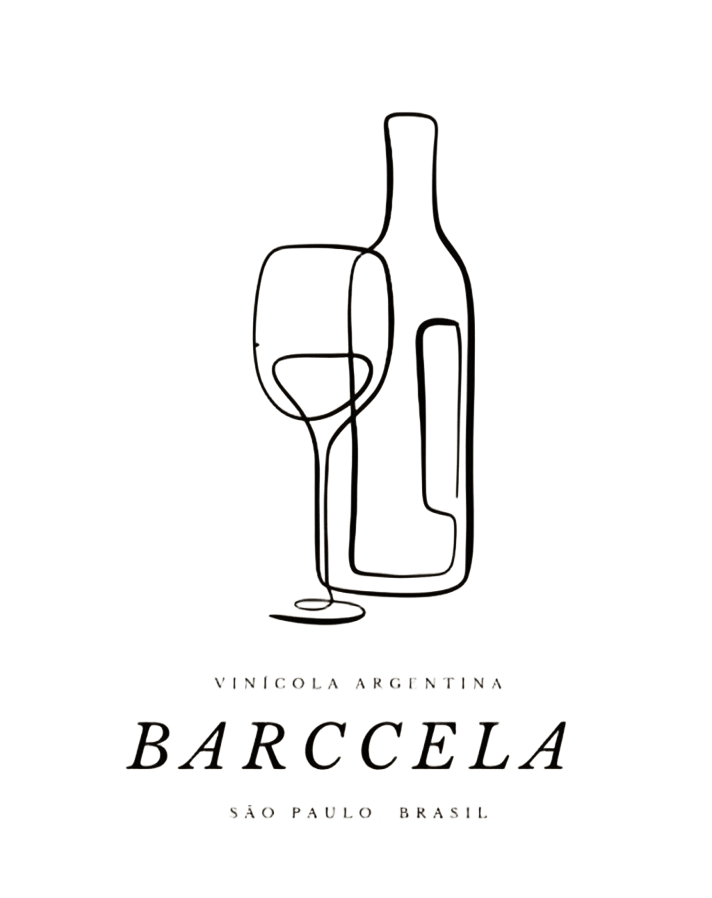

# Tailwind Pages

Páginas de estudo feitas com Tailwind CSS: a landing page fictícia da Vinícola Barccela e um layout de exercício.

🔗 **Demo:** https://matheusdiamantino.github.io/Tailwind-Pages/

## O que foi praticado

- **Tailwind CSS** via CDN
- Landing page responsiva com seções de produtos, sobre e contato (`index.html`)
- Layout de grade com textos de exemplo (`PageTailwind.html`)

## Como abrir

Abra o `index.html` ou o `PageTailwind.html` no navegador.
